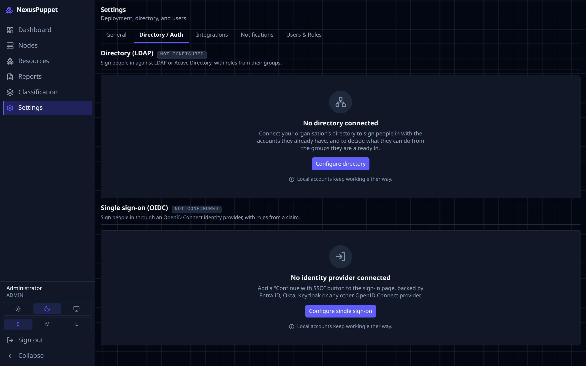
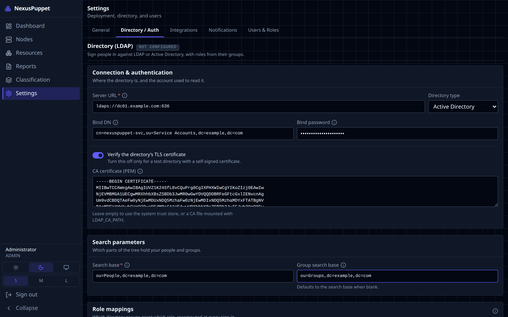

# Sign-in & users

People sign in with a **local account** (a password kept by NexusPuppet), a **directory account** (LDAP or Active Directory), or **single sign-on** (OIDC — Entra ID, Okta, Keycloak and others). You can use all three at once. Local accounts always keep working, whatever you do with a directory.

> **Who gets in.** Directory (LDAP / Active Directory) users sign in with their **username** — `jdoe` — or their UPN or email, and NexusPuppet finds their account by asking the directory first. Tick **Create accounts automatically for people in a mapped group** and anyone in a mapped group gets an account at their first sign-in; leave it off and an administrator creates each account first, in **Settings → Users & Roles**. Single sign-on (OIDC) users always need an account created first. Without one, a correct password is refused with the same message as a wrong one.

## Roles

| Role | Can |
|---|---|
| **VIEWER** | Read everything: nodes, facts, reports, classification |
| **OPERATOR** | Everything a viewer can, plus change classification |
| **ADMIN** | Everything, including users and settings |

These three are fixed. To make your own, duplicate one in **Settings → Users & Roles** and change its permissions.

## Local accounts

**Add someone:** **Settings → Users & Roles → New user**. Enter their email, a display name, a role and a first password. Send them the password through a safe channel and ask them to change it.

**Change your own password:** **Settings → General → Change your password**. This signs you out everywhere else.

**Reset someone else's password:** an administrator opens **Settings → Users & Roles** and uses the key button on that person's row to set a new one. Directory and single sign-on users change their password in the directory, not here.

**Locked out after too many attempts?** The lock lifts by itself after a while, or another administrator can reset the password.

Two safety rules: you cannot delete or deactivate your own account, and you cannot remove the last active administrator.

### Forgotten administrator password

If another administrator can sign in, they can set a new password for you as above. If nobody can, reset it on the server, from the install directory (usually `/opt/nexuspuppet`):

```bash
sudo ./scripts/deploy.sh --reset-admin admin@example.com
```

It asks for the new password twice, without showing it. It works even when the API is down. It sets the password, unlocks and reactivates the account, ends its sessions, and records `user.password.reset` in the audit log. It is for local accounts only; directory and single sign-on users reset their password in the directory.

Available from the release after v1.11.0. The command lives in the console's image, so **on a server last upgraded to v1.11.0 or earlier, run the upgrade once first** — it rebuilds the image and needs no login — then run the command:

```bash
sudo ./scripts/deploy.sh
sudo ./scripts/deploy.sh --reset-admin admin@example.com
```

If you skip that, the command says so before asking for a password, and changes nothing.

## Connect LDAP or Active Directory

Everything happens in the console. There is no file to edit and nothing to restart.



1. **Be on 1.11 or later, installed with `scripts/deploy.sh`.** It adds the `CONFIG_ENCRYPTION_KEY` the console needs to store the bind password (see [Install & upgrade](install.md#upgrade)). If the page says *Saving a bind password needs CONFIG_ENCRYPTION_KEY*, re-run `./scripts/deploy.sh`.
2. Open **Settings → Directory / Auth**. The **Directory (LDAP)** section says **Not configured**. Click **Configure directory**.
3. Fill in the connection:
    - **Server name or IP** — use the server's **name**, exactly as it appears on its certificate: `dc01.example.com`. The certificate is checked against it, so an IP address only works if the certificate lists that IP — domain controller certificates rarely do. No `ldaps://`, no port.
    - **Protocol** — how the connection is encrypted. There is no unencrypted option.
        - **LDAPS**: TLS from the first byte. Usually port **636** (3269 for an AD Global Catalog).
        - **STARTTLS**: connects on the plain LDAP port, usually **389** (3268 for a Global Catalog), and switches to TLS before anything else is sent. If the server will not switch, nothing is sent and the test says *The server refused STARTTLS*.
    - **Port** — fills itself in from the protocol (636 or 389). Type your own and it stays.
    - **Bind type** — how NexusPuppet finds people:
        - **Regular** (default): a service account finds each person, who then signs in as themselves. Fill in **User DN** — the service account, such as `cn=nexuspuppet-svc,ou=Service Accounts,dc=example,dc=com` — and its **Password**.
        - **Simple**: no service account; each person signs in directly. Fill in **User DN pattern**, which says how to turn what they type into the identity the directory checks: `{username}` is what they type, or the part of an address before the `@`; `{email}` is a whole address.
            - **Active Directory:** `{username}@corp.local` — people type `jdoe`. `{email}` binds as the address typed, so it only works when that address **is** the person's UPN (`alice@corp.local`); the login field then asks for an email.
            - **OpenLDAP:** `uid={username},ou=People,dc=example,dc=com` (or `cn={email},…` if entries are named by address).

            People must be allowed to read their own entry. With `{username}`, someone who types an **address** must type one of their entry's own (its mail or UPN), so `alice@one.example` cannot use the entry of `alice@two.example`. Simple has no service account to check addresses with, so an account you created by hand is linked the first time its owner signs in with **that address** — after that, their username works too.
        - **Anonymous**: people are found without signing in, then sign in as themselves. The directory must allow anonymous search.
    - **Directory type** is not something you choose. It is read from the server (*Detected: Active Directory* or *OpenLDAP*) when you test or save.
    - Leave **Verify the directory's TLS certificate** on.
    - **CA certificate (PEM)** — paste the certificate of the CA that signed the directory's certificate, from `-----BEGIN CERTIFICATE-----` to `-----END CERTIFICATE-----`. Include intermediates if there are any. It is public; never paste a private key. Not needed if the directory's certificate comes from a public CA. It is used for LDAPS and STARTTLS alike.
4. Fill in **Search base** — where your users are, such as `dc=example,dc=com`. **Group search base** is optional.
5. Under **Role mappings**, map at least one directory group to a role, for example `cn=puppet-admins,ou=Groups,dc=example,dc=com` → `ADMIN`. **A user in none of the mapped groups is refused.** There is no default role for LDAP.

    Below the mappings, **Create accounts automatically for people in a mapped group** decides whether people need an account created for them first (step 8). With it ticked, someone with no account who signs in and is in a mapped group gets one — keyed by their directory email (`mail`, or the UPN when `mail` is empty), with the role their group maps to — and every creation is recorded in the audit log as `user.create` by `directory:ldap`. **Map specific groups, never `Domain Users`:** with this ticked, the mappings are your access list — anyone who can sign in to the directory and is in a mapped group gets in.
6. Click **Test connection**. It connects, reads what kind of directory this is, and binds and searches with what you typed, without saving. (With **Simple** there is no service account to search with, so the test stops at connecting.) Fix anything it reports — see [When the test fails](troubleshooting.md#the-directory-test-fails).
7. Click **Save**. It applies from the next sign-in; the badge changes to **Saved in the console**, and **Directory type** shows what was detected. Save runs the same check as **Test connection**: if NexusPuppet cannot connect with what you saved, the settings are kept but a warning says *Saved, but NexusPuppet cannot connect with these settings: …* and why. Directory users cannot sign in until you fix it.
8. **Accounts.** With automatic creation ticked (step 5), skip this: accounts appear in **Settings → Users & Roles** as people sign in. Otherwise create each one in **Settings → Users & Roles → New user**, with **Authentication** `ldap` and no password. The role you pick is replaced at each sign-in by what their groups map to. Use an email that is **on their directory entry**, so the account can be linked to them:
    - **OpenLDAP:** their `mail`.
    - **Active Directory:** their `mail` (usually their work email, `alice@example.com`) **or** their UPN (`alice@corp.local`).
9. **Sign in.** People type their **username** (`jdoe`), their UPN or their email — the login field says **Username or email**. NexusPuppet asks the directory who that is, then opens the account **linked** to their directory entry. The first time, it links the account you created whose email is the entry's mail or UPN, and records `user.directory.link` in the audit log; from then on the link — the entry's `objectGUID` on AD, `entryUUID` on OpenLDAP — finds the account, whatever they type and even if their mail or UPN changes.

    A **local** account is never linked to a directory entry and never opened with a directory password, even when its email is someone's mail: local accounts sign in with their own password, by their own email, as before.



**Configured before 1.13?** Your settings keep working unchanged and open in the new fields. One saved with an unencrypted `ldap://` URL shows **Protocol** as *Unencrypted (legacy)*; it still signs people in, but to save any change you must choose LDAPS or STARTTLS.

You can create accounts before the directory is configured; the dialog marks the source *not configured yet*, and those people can sign in once you save. The login page only offers a directory once it is configured.

**A person moved to a new directory entry** (a new domain, say) keeps their account, but it stays linked to the old entry and is refused, with *linked to a different directory entry* in the log. To re-link it, change the account's authentication to `local` and back to `ldap` in **Users & Roles** — that clears the link — and they are linked again at their next sign-in.

To undo, open the form and use **Discard stored settings**. Directory users are then refused at their next sign-in; local accounts are unaffected.

## Connect single sign-on (OIDC)

1. Register NexusPuppet with your identity provider. The redirect URI is `https://<your console>/api/auth/callback`.
2. Open **Settings → Directory / Auth**, find **Single sign-on (OIDC)**, and click **Configure single sign-on**.
3. Enter the **Issuer**, **Client ID**, **Client secret** and the same **Redirect URI**. Check the **Claims** that carry email, display name and groups.
4. Map group claim values to roles under **Role mappings**, or set a **Role for everyone else**.
5. Test, then **Save**. The login page now shows a single sign-on button.
6. Create each person's account with **Authentication** set to `oidc`. Single sign-on does not create accounts at first sign-in.

On Entra ID, limit the groups claim to the groups assigned to the application. Entra stops sending groups for people in more than about 150 of them, and those users are refused. More in [DEPLOYMENT.md](../../DEPLOYMENT.md#pointing-at-entra-id-oidc).

## Configuring from `.env` instead

The `LDAP_*` and `OIDC_*` variables in `.env` still work, and need an API restart to change. Settings saved in the console take precedence over them. [DEPLOYMENT.md](../../DEPLOYMENT.md#2-one-image-every-feature) has the details.
